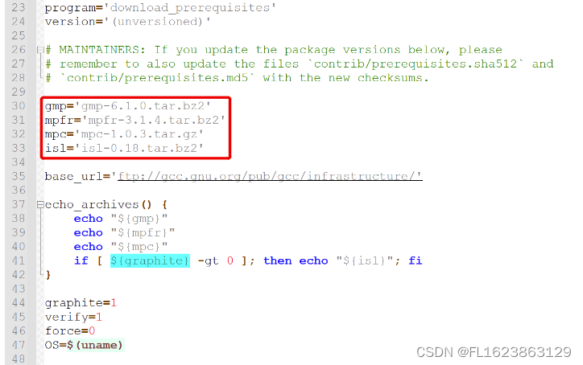

# Ubuntu [GCC] GCC source code download and compilation process

1. Download the gcc installation package and search for the official address to download it. If you cannot download it, try downloading it from gitee.com/FIRC/gcc-cn-

1. To download the GCC installation package, search for the official address and download it. If you encounter issues with downloading, try selecting a required version of GCC from gitee.com/FIRC/gcc-cn-mirror. Note that if you are downloading the source code of GCC-CN mirror, skip steps 2 and 3 and proceed directly to step 4 to start compiling.

2. Download dependency packages

Editor

According to the information in the red box in download_prerequisites, download the corresponding dependency package version from the below download link.

Dependency package download address: Locate the corresponding address in the source code base_url, open it, and find the corresponding version installation package.

3. Compile gcc The version of gcc used in this article and its dependencies are as follows:

gcc-9.10 gmp-6.1.0 mpfr-3.1.4 mpc-1.0.3 isl-0.18

Copy the gcc-9.10 installation package to Linux and unzip it.

tar -zxvf gcc-9.10.tar.gz cd into gcc-9.10 directory

cd gcc-9.10 Copy the dependencies to gcc-9.10 and unzip them.

tar -zxvf gmp-6.1.0.tar.bz2 tar -zxvf mpfr-3.1.4.tar.bz2 tar -zxvf mpc-1.0.3.tar.gz tar -zxvf isl-0.18.tar.bz2

ln -sf gmp-6.1.0 gmp ln -sf mpfr-3.1.4 mpfr ln -sf mpc-1.0.3 mpc ln -sf isl-0.18 isl Compile gcc (Compilation time approximately 30 minutes to an hour)

4. Create the build directory

mkdir build && cd build

unset LIBRARY_PATH CPATH C_INCLUDE_PATH PKG_CONFIG_PATH CPLUS_INCLUDE_PATH INCLUDE

# Configuration

../configure -enable-checking=release -enable-languages=c,c++ --disable-multilib

# Compilation

make -j8

5. Installation Since there is no root permission, it cannot be installed to /usr/local, so other paths need to be specified.

# The following DESTSDIR=/home is just for demonstration, please choose your own installation path.

# Create a new file bashrc and vim bashrc # Enter the following information

export PATH=/home/usr/local/bin:$PATH

export LD_LIBRARY_PATH=/home/usr/local/lib64:$LD_LIBRARY_PATH

# Save :wq

# Update environment variables (need to run the below command again every time you open a shell) .bashrc or source bashrc to check gcc version

gcc --version shows the following information, configuration completed.

gcc (GCC) 9.1.0 Copyright (C) 2019 Free Software Foundation, Inc. This is free software; see the source for copying conditions.  There is NO warranty; not even for MERCHANTABILITY or FITNESS FOR A PARTICULAR PURPOSE.

Up to this point, the Linux offline upgrade of gcc has been completed without root privileges. The new version of gcc can be used for compilation under the current shell.

## Payment

Here is a pay link on Stripe ( https://buy.stripe.com/3cs8yP7sY87d0vu9AB ). Please contact me lonlonago@foxmail.com after funding $89, and I will send you a complete data files , thank you!

